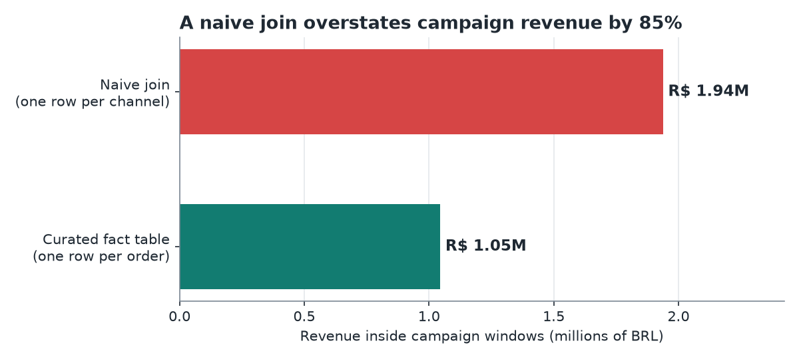
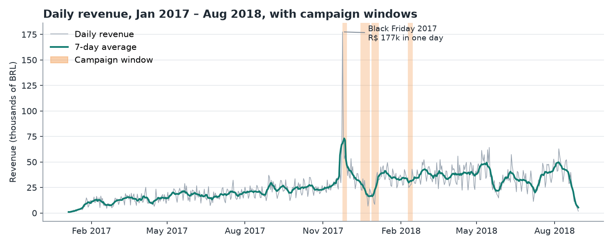
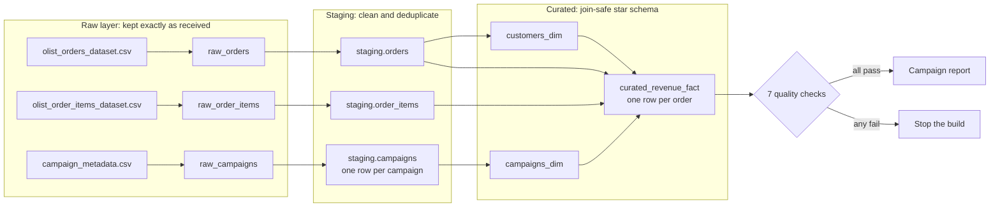

# Promotion Impact Pipeline: is campaign revenue real or inflated?

A reproducible **DuckDB + Python** data pipeline that turns the public Olist Brazilian e-commerce data into a join-safe fact table and uses it to measure revenue during marketing campaigns, without the double counting that naive joins cause.


---

## The question

> When an online store runs campaigns (Black Friday, Christmas and so on), is the revenue lift real, or does it only *look* bigger because of how the data is joined?

The same campaign often runs on several channels at once (email, social, display ads). If you join orders to that campaign list directly, an order placed during Black Friday matches **two or three rows** and its revenue is counted two or three times. On top of that, orders have many items, so joining items, orders and campaigns together multiplies rows again. The numbers look great, and they are wrong.

This project builds a pipeline that prevents that, proves it with automated checks, and then answers the question with numbers you can trust.

## Key results

| | Result |
|---|---|
| Orders in the curated fact table | **97,887** (Sep 2016 – Sep 2018) |
| Total revenue (price + freight) | **R$ 15.67 million** |
| Quality checks passed | **7 of 7** (no orphans, no duplicates, nothing lost, nothing extra) |
| Revenue inflation from a naive join | **+85%** (R$ 1.94M reported vs R$ 1.05M real) |
| Revenue per day on campaign days vs other days | **+32%** (R$ 33.7k vs R$ 25.5k) |
| Average order value on campaign days | **7% lower** (R$ 149 vs R$ 161) |
| Rebuild reproducibility | Same checksum on every run: `8dd3e47715074f17a00ba9a709cdb96f` |



### Not every campaign is a lift

Comparing each campaign window with the four weeks before it shows that the "campaign lift" is almost entirely **Black Friday**:

| Campaign | Revenue per day in window | Revenue per day, prior 4 weeks | Change |
|---|---:|---:|---:|
| Black Friday 2017 | R$ 100,804 | R$ 27,878 | **+262%** |
| Cyber Monday 2017 | R$ 56,220 | R$ 36,460 | +54% |
| Christmas 2017 | R$ 21,727 | R$ 45,176 | −52% |
| New Year 2018 | R$ 23,105 | R$ 29,791 | −22% |
| Carnival 2018 | R$ 30,631 | R$ 35,137 | −13% |



Christmas, New Year and Carnival all sit **below** the weeks before them, most likely because people order gifts early and buy less during the holidays themselves. Reporting a single average lift across all campaigns would hide this.

> **Caveat:** Olist never published its real promotions, so the campaign file in this project is **synthetic**: its windows are placed on real holidays. The results show holiday seasonality and the effect of correct vs incorrect joins, not proof that a specific campaign caused a sale.

## How the pipeline works



### 1. Raw layer: the evidence locker
Each CSV is loaded **as is** with `CREATE OR REPLACE TABLE … AS SELECT * FROM read_csv_auto(…)`. Nothing is cleaned here, so any later number can be traced back to the source.

### 2. Staging layer: clean and deduplicate
- **Orders:** IDs trimmed, timestamps cast, and only real purchases kept (`delivered`, `shipped`, `in transit`, `processing`, `approved`). Cancelled and unavailable orders are dropped.
- **Order items:** price and freight cast to numbers; rows with missing keys dropped.
- **Campaigns:** the source has one row **per campaign per channel**. `ROW_NUMBER() OVER (PARTITION BY campaign_id …) = 1` keeps one row per campaign, which is the step that prevents the 85% inflation above.

### 3. Curated layer: a join-safe star schema
- **`campaigns_dim`** and **`customers_dim`** with surrogate keys (`DENSE_RANK()`).
- **`curated_revenue_fact`** at the grain of **one row per order**. Item revenue is summed per order **before** joining, so an order with three items still produces one row. Every other join is many-to-one, so `SUM(order_revenue)` counts each order exactly once.

### 4. Quality gate
Every build writes its checks to an `audit_results` table, tagged with a run ID, and **fails the build** if any check finds a problem:

| Check | What it proves |
|---|---|
| C1 No orphan `campaign_sk` | Every campaign in the fact table exists in the campaign dimension |
| C2 No orphan `customer_sk` | Every customer in the fact table exists in the customer dimension |
| C3 Unique campaigns | No duplicate `campaign_id` in the dimension |
| C4 Unique customers | No duplicate `customer_id` in the dimension |
| C5 Unique fact grain | No duplicate `order_id` in the fact table |
| R1 Nothing lost | Every staged order with items reached the fact table |
| R2 Nothing extra | The fact table contains no order that wasn't expected |

### 5. Reproducibility
The build prints an **MD5 checksum** of the ordered fact table. Rebuilding from the same raw files always gives the same checksum, so you can prove two runs produced identical data.

## Design decisions and trade-offs

| Decision | Why | Trade-off |
|---|---|---|
| **Snapshot tables** (`CREATE OR REPLACE TABLE AS`) instead of views | Each run produces a fixed, auditable result; reports don't change until the pipeline is deliberately rerun | Uses more storage, and data is only as fresh as the last build |
| **Order grain** for the fact table (not item grain) | The business question is about order revenue; one row per order makes sums safe by construction | Product- or seller-level analysis needs a separate item-grain fact |
| **Pre-aggregate items before the join** | Prevents one-to-many row multiplication | The fact table no longer holds item detail |
| **Deduplicate campaigns in staging** | Stops channel duplicates from multiplying revenue | Channel-level attribution (which channel drove the sale) is not modelled |
| **Date-window campaign matching** | The data has no coupon-usage field, so purchase date is the only link | Every order in a window is counted as "campaign", whether or not a coupon was used |
| **Checks stored in `audit_results`** with a run ID | Creates a history of every build's quality | One more table to maintain |

## Repository structure

```
.
├── build.py                          # The whole pipeline: raw → staging → curated → checks → checksum
├── promotion_impact_pipeline.ipynb   # Step-by-step walkthrough with outputs and analysis
├── data/
│   ├── README.md                     # How to download the Olist dataset
│   └── raw/
│       └── campaign_metadata.csv     # Synthetic campaign windows (included)
├── assets/                           # Charts used in this README
├── requirements.txt
└── LICENSE
```

## Run it yourself

**1. Get the code and install the packages** (Python 3.10 or newer):

```bash
git clone https://github.com/akotechonline/olist-promotion-impact-pipeline.git
cd olist-promotion-impact-pipeline
python -m venv .venv
source .venv/bin/activate        # Windows: .venv\Scripts\activate
pip install -r requirements.txt
```

**2. Download the data.** The Olist CSV files aren't stored in this repository. Download them from [Kaggle](https://www.kaggle.com/datasets/olistbr/brazilian-ecommerce) and put them in `data/raw/`. See [`data/README.md`](data/README.md) for details.

**3. Build the pipeline:**

```bash
python build.py --show-all-checks
```

Expected output:

```
BUILD OK: curated_revenue_fact rows = 97887
run_id=...
curated_checksum=8dd3e47715074f17a00ba9a709cdb96f
CHECK SUMMARY:
  - C1_no_orphans_campaign_sk: 0 (None)
  ...
ALL CHECKS PASSED
```

This creates `promotion.duckdb` next to the script. The script exits with code `1` if any check fails, so it can run in CI.

**4. Explore the walkthrough:**

```bash
jupyter notebook promotion_impact_pipeline.ipynb
```

## Skills demonstrated

- **SQL data modelling:** layered raw/staging/curated design and a star schema with surrogate keys
- **Join-cardinality control:** pre-aggregation and deduplication to keep a declared grain
- **Data quality engineering:** orphan, uniqueness and reconciliation checks with a fail-fast gate
- **Reproducible pipelines:** idempotent rebuilds, run IDs and checksums
- **Window functions:** `ROW_NUMBER()` for deduplication and `DENSE_RANK()` for surrogate keys
- **Analytical reasoning:** separating real effects from data-assembly artifacts, and stating the limits of the conclusions

## About this project

Built as the midterm project for **IS 455 – Database Design & Prototyping** (Spring 2026). The brief asked for a reproducible DuckDB + Python pipeline on real-world data, with separate raw and curated layers, `CREATE OR REPLACE TABLE AS` rebuilds, a documented design trade-off, and a join-safe fact table that keeps its event grain.

The follow-up final project, [promo-attribution-incremental-etl](https://github.com/akotechonline/promo-attribution-incremental-etl), extends this work to data that changes over time, with incremental rebuilds and run monitoring.

For this portfolio version I corrected a few notebook explanations so they match the code exactly, and added the follow-up analysis (sections A–C at the end of the notebook: naive-join inflation, revenue per day, and the campaign-by-campaign comparison). The pipeline code in `build.py` is unchanged from the submission.

## Data and license

- **Olist data:** [Brazilian E-Commerce Public Dataset by Olist](https://www.kaggle.com/datasets/olistbr/brazilian-ecommerce), released under [CC BY-NC-SA 4.0](https://creativecommons.org/licenses/by-nc-sa/4.0/). It is not redistributed here.
- **Campaign metadata:** synthetic, created for this project.
- **Code:** MIT License (see [`LICENSE`](LICENSE)).

## Author

**Rasheed Akorede Adigun** · [GitHub @akotechonline](https://github.com/akotechonline)
